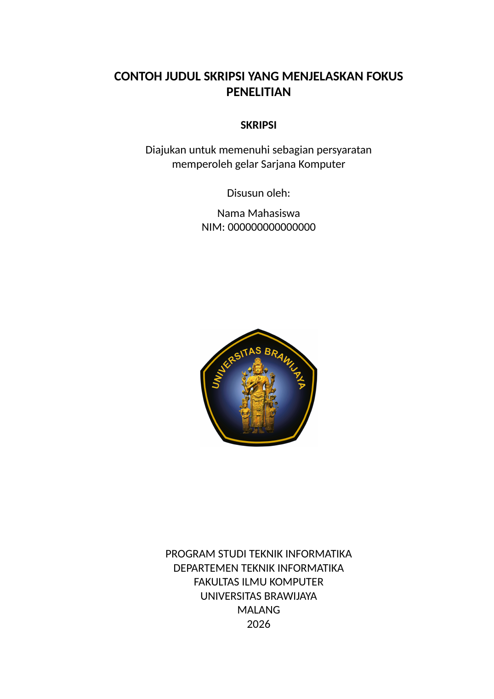

# Template Skripsi LaTeX FILKOM UB — Universitas Brawijaya

[](https://github.com/Vallykrie/skripsi-filkom-latex/actions/workflows/ci.yml)
[](LICENSE)

Template LaTeX skripsi untuk mahasiswa **Fakultas Ilmu Komputer, Universitas Brawijaya (FILKOM UB)**. Mulai dari metadata, halaman awal, Bab 1–6, daftar referensi, dan lampiran; tersedia jalur kompilasi lokal dan Overleaf.

**[Gunakan template](https://github.com/Vallykrie/skripsi-filkom-latex/generate)** · **[Unduh ZIP v0.1.0](https://github.com/Vallykrie/skripsi-filkom-latex/archive/refs/tags/v0.1.0.zip)** · **[Contoh PDF](https://github.com/Vallykrie/skripsi-filkom-latex/releases/download/v0.1.0/skripsi-preview.pdf)** · **[Panduan mulai](docs/getting-started.md)** · **[Overleaf](docs/overleaf.md)**



Template komunitas ini **bukan template resmi yang diterbitkan atau disahkan FILKOM UB**. Pedoman kampus terbaru, ketentuan program studi, dan arahan dosen pembimbing menjadi acuan utama. Periksa naskah sebelum diajukan; keberhasilan kompilasi tidak membuktikan persetujuan akademik.

## Yang disediakan

- Kelas `filkomskripsi.cls` dan berkas utama `skripsi.tex`.
- Identitas dan judul melalui `metadata.tex`.
- Sampul, lembar persetujuan, pernyataan orisinalitas, prakata, abstrak Indonesia, dan abstrak Inggris.
- Daftar isi, gambar, tabel, serta lampiran.
- Kerangka enam bab untuk skripsi nonimplementatif: Pendahuluan, Landasan Kepustakaan, Metodologi, Hasil, Pembahasan, dan Penutup.
- Contoh penulisan tabel, gambar, persamaan, sitasi, dan lampiran yang dapat diganti dengan isi penelitian Anda.
- Skrip build dengan XeLaTeX dan Biber; pratinjau menggunakan Carlito, sedangkan build `official` menggunakan Calibri yang diperoleh secara legal.

Kerangka bab dapat disesuaikan untuk penelitian implementatif; lihat [penyesuaian naskah](docs/customization.md). Lembar persetujuan dan orisinalitas adalah format kosong untuk diisi sesuai fakta, bukan bukti bahwa naskah telah disahkan. Lembar pengesahan tersedia terpisah untuk diaktifkan setelah proses ujian/revisi benar-benar disahkan.

## Mulai cepat

1. Klik **[Use this template](https://github.com/Vallykrie/skripsi-filkom-latex/generate)** atau unduh ZIP, lalu buka folder hasilnya.
2. Ubah identitas dan judul di [`metadata.tex`](metadata.tex).
3. Tulis isi pada `frontmatter/`, `chapters/`, dan `appendices/`; ganti contoh referensi di `bibliography/references.bib` dengan sumber yang benar-benar digunakan.
4. Pasang distribusi TeX yang menyediakan **XeLaTeX**, **Biber**, **latexmk**, dan font **Carlito**, serta **Python 3**. Jalankan dari folder akar:

   ```bash
   python3 scripts/build.py preview
   ```

5. Buka `build/skripsi-preview.pdf` dan periksa susunan halaman, tabel/gambar, sitasi, serta daftar lampiran.

Untuk Overleaf, unggah ZIP, pilih **XeLaTeX**, dan set berkas utama **`skripsi.tex`**. Petunjuk lengkap ada pada [panduan Overleaf](docs/overleaf.md).

## Kompilasi dan pemeriksaan

| Tujuan | Python | Make | Hasil |
|---|---|---|---|
| Pratinjau dengan Carlito | `python3 scripts/build.py preview` | `make preview` | `build/skripsi-preview.pdf` |
| Build dengan Calibri | `python3 scripts/build.py official` | `make official` | `build/skripsi-official.pdf` |
| Periksa build | `python3 scripts/build.py check` | `make check` | Pemeriksaan hasil kompilasi |
| Jalankan pengujian template | — | `make test` | Hasil pengujian |
| Bersihkan artefak build | `python3 scripts/build.py clean` | `make clean` | Membersihkan keluaran kompilasi |

Nama mode `official` menunjukkan penggunaan font Calibri yang ditentukan template; **mode tersebut bukan pengesahan resmi dari kampus**. Skrip `preview` memakai Carlito agar pemeriksaan dapat direproduksi tanpa mendistribusikan Calibri. Saat `skripsi.tex` dikompilasi langsung, pemilihan font otomatis mencoba Calibri kemudian Carlito. Dokumentasi font ada pada [panduan penyesuaian](docs/customization.md).

Calibri adalah font proprietary dan tidak disertakan dalam repository maupun ZIP publik. Gunakan instalasi lokal atau berkas font yang memang boleh Anda pakai, dan simpan proyek yang memuat font tersebut secara privat. Logo UB mempunyai status terpisah dari kode template; lihat [`NOTICE`](NOTICE).

## Struktur proyek

```text
skripsi.tex                 # berkas utama
filkomskripsi.cls            # pengaturan tata letak
metadata.tex                # judul dan identitas
frontmatter/                # halaman awal dan dua abstrak
chapters/                   # Bab 1–6
bibliography/               # database dan gaya referensi
appendices/                 # lampiran
assets/                     # aset yang digunakan naskah
scripts/                    # build dan pemeriksaan
docs/                       # petunjuk penggunaan
build/                      # keluaran kompilasi, bukan sumber naskah
```

## Dokumentasi

- [Mulai di komputer lokal](docs/getting-started.md)
- [Unggah dan kompilasi di Overleaf](docs/overleaf.md)
- [Ubah metadata, font, bab, dan lampiran](docs/customization.md)
- [Kelola sitasi dan daftar referensi](docs/bibliography.md)
- [Atasi masalah kompilasi](docs/troubleshooting.md)
- [Acuan format dan batas kepatuhan](docs/compliance.md)
- [Kontribusi dan pelaporan masalah](CONTRIBUTING.md)
- [Riwayat perubahan](CHANGELOG.md)
- [Asal sumber dan aset](SOURCE_PROVENANCE.json)
- [Catatan bantuan AI](AI_ASSISTANCE.md)

Untuk tahap proposal, gunakan repository pendamping **[Template Proposal Skripsi LaTeX FILKOM UB](https://github.com/Vallykrie/proposal-skripsi-filkom-latex)**. Format proposal dan skripsi dipisahkan agar halaman awal dan bab lanjutannya dapat dikelola sesuai tahap penulisan.

## Pertanyaan umum

### Apakah template ini resmi dari FILKOM UB?

Tidak. Ini proyek komunitas untuk membantu penulisan. Periksa pedoman dan arahan pembimbing yang berlaku untuk Anda, lalu laporkan perbedaan format dengan rujukan yang jelas.

### Apakah bisa digunakan di Overleaf?

Ya. Pilih XeLaTeX dan `skripsi.tex` sebagai berkas utama. Carlito menyediakan jalur pratinjau tanpa mengunggah Calibri; penggunaan Calibri membutuhkan font yang Anda peroleh dan gunakan secara legal.

### Apakah template ini hanya untuk penelitian nonimplementatif?

Struktur awalnya nonimplementatif. Untuk penelitian implementatif, judul dan isi bab dapat diubah tanpa kelas tambahan. Sepakati struktur dengan pembimbing; contoh penyesuaian terdapat pada [dokumentasi](docs/customization.md).

### Apa perbedaan PDF preview dan official?

Skrip preview memakai Carlito, sedangkan skrip official mensyaratkan Calibri. Pergantian font dapat mengubah pemenggalan dan jumlah halaman; periksa PDF akhir setelah mengganti font.

### Bolehkah langsung mengisi lembar persetujuan?

Isi identitas dan naskah sesuai fakta. Nama penguji, tanggal, tanda tangan, serta status persetujuan hanya diisi melalui proses akademik yang sebenarnya.

## Kontribusi, lisensi, dan atribusi

Laporan masalah format, contoh minimal, dan perbaikan dokumentasi dipersilakan melalui [Issues](https://github.com/Vallykrie/skripsi-filkom-latex/issues) atau pull request. Baca [CONTRIBUTING.md](CONTRIBUTING.md) sebelum mengirim perubahan.

Kode dan dokumentasi template menggunakan **LPPL 1.3c atau versi lebih baru**; lihat [`LICENSE`](LICENSE). Lisensi tersebut tidak memberikan hak baru atas logo Universitas Brawijaya atau font pihak ketiga; rincian aset terdapat pada [`NOTICE`](NOTICE). Metadata sitasi perangkat lunak tersedia dalam [`CITATION.cff`](CITATION.cff).

## English summary

A community LaTeX thesis template for the Faculty of Computer Science, Universitas Brawijaya (FILKOM UB). It provides front matter, Indonesian and English abstracts, six analytical research chapters, references, and appendices. Build locally with XeLaTeX and Biber or upload to Overleaf. Preview builds use Carlito; Calibri builds require legally obtained fonts. This project is not an official university release or an academic approval. Follow current faculty guidance and your supervisors' instructions.
